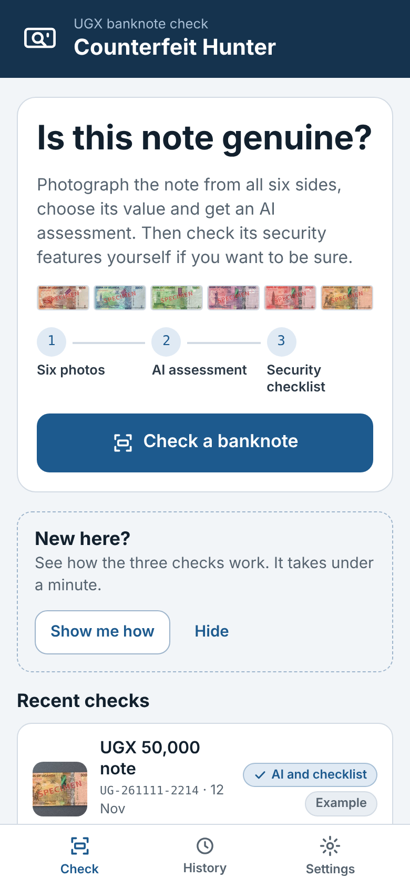
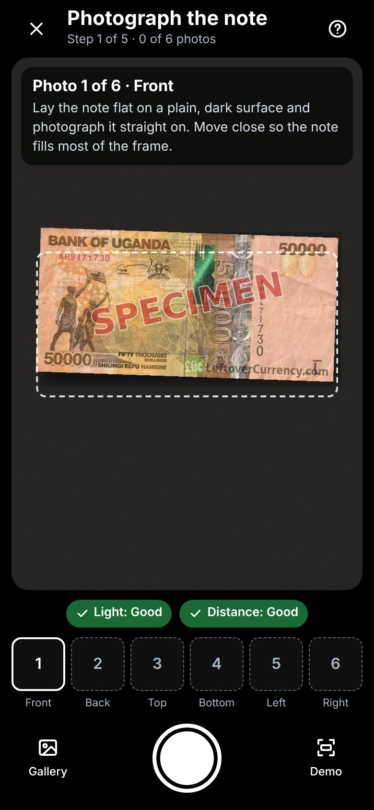
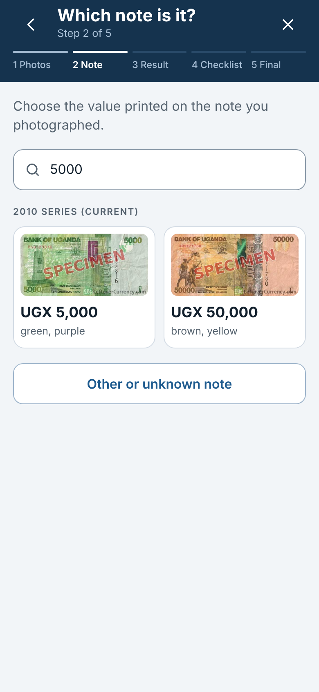
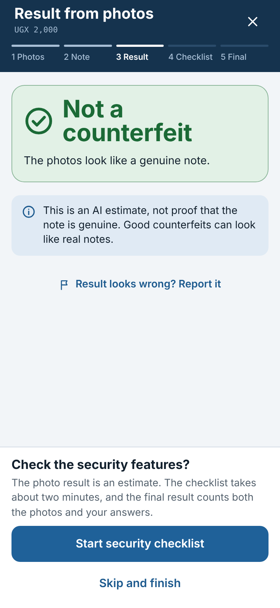
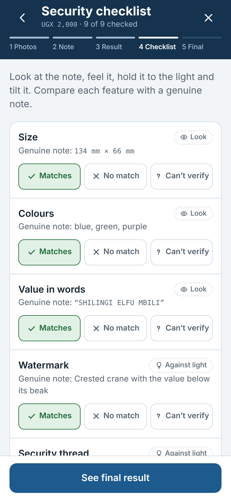
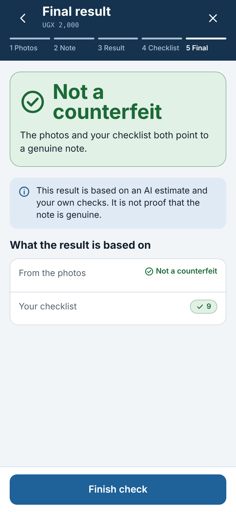
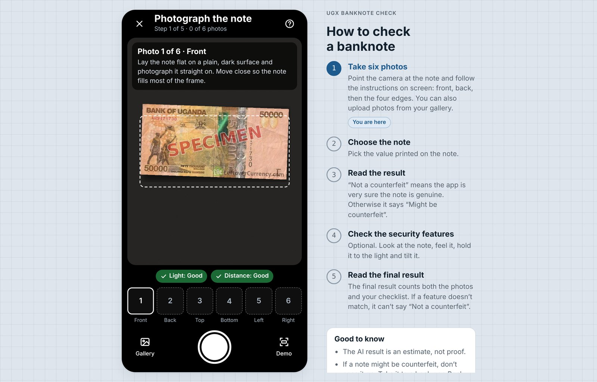

# Counterfeit Hunter

Check a Ugandan shilling (UGX) banknote with a phone camera: take six photos,
get an AI estimate, and if you want to be sure, go through the note's security
features yourself.

A prototype by Team 2 for the IS Project course.

> [!WARNING]
> The AI model in this prototype is **simulated**. Its results only demonstrate
> the interface. Don't use the app to decide whether a real banknote is genuine.

**Live demo:** `https://<your-username>.github.io/<repository-name>/`
(see [Publish on GitHub Pages](#publish-on-github-pages))

<table>
  <tr>
    <td align="center"><br><sub>Home</sub></td>
    <td align="center"><br><sub>1. Six photos</sub></td>
    <td align="center"><br><sub>2. Choose the note</sub></td>
  </tr>
  <tr>
    <td align="center"><br><sub>3. Result from the photos</sub></td>
    <td align="center"><br><sub>4. Security checklist</sub></td>
    <td align="center"><br><sub>5. Final result</sub></td>
  </tr>
</table>

## How a check works

| Step | What happens |
|---|---|
| 1. Six photos | "Check a banknote" opens the back camera straight away. The screen says which photo to take next: the front, the back, then the four edges. Light and distance are checked live, and a photo that fails gets a warning with Retake or Keep anyway. Photos can also come from the gallery. |
| 2. Choose the note | Pick one of the six notes of the 2010 series, or "Other or unknown note". A search box finds a note by value, colour or a picture printed on it. |
| 3. Result from the photos | One of two answers: **Not a counterfeit** or **Might be counterfeit**, marked as an AI estimate. The app then asks whether to do the security checklist. |
| 4. Security checklist | Optional. Nine or ten features to look at, feel, hold to the light and tilt, each with a description of what a genuine note shows. |
| 5. Final result | A second answer that counts both the photos and the checklist. If the note might be counterfeit, the user can request bank verification. |

Every check is saved to History, where it can be opened again or copied as a
text summary.

## Features

- **Camera first.** Live viewfinder with a guide frame and light and distance
  checks before the photo is taken. Where the browser doesn't allow the live
  camera, the round button opens the phone's camera app instead and the checks
  run after each photo.
- **Two plain answers.** "Not a counterfeit" only when the model is at least
  95% sure; anything less is "Might be counterfeit". The certainty itself stays
  inside the app.
- **Security checklist** based on the Bank of Uganda's description of the 2010
  series: size, colours, value in words, watermark, security thread,
  see-through image, colour-change image, foil image (10,000 and up),
  iridescent band and raised print.
- **Bank verification.** The serial number, where the note was received and
  how many similar notes came in the same payment, saved with the check.
- **English, Kiswahili and Finnish**, light and dark theme, large text and high
  contrast.
- **Administrator settings** (demo PIN `1234`): the required certainty and a
  forced demo outcome for presentations.
- **Guide panel.** On a computer the app sits in a phone frame with a
  step-by-step guide beside it.

<p align="center">
  
</p>

## Run it on your computer

The app is plain HTML, CSS and JavaScript with no build step and nothing to
install. It loads its code as JavaScript modules, which browsers won't do from
a file opened by double-clicking, so it needs a small local web server. Python
has one built in.

1. Open a terminal in the project folder.
2. Start the server: `py -m http.server 8000` on Windows, or
   `python3 -m http.server 8000` on macOS and Linux.
3. Open <http://localhost:8000>. Stop the server with Ctrl+C.

On `localhost` the live camera works with the computer's webcam.

To try it on a phone on the same Wi-Fi, open `http://<your computer's IP>:8000`
on the phone. Phones only allow the live camera on `https`, so over this plain
`http` address the app falls back to the camera app. For the live camera on a
phone, use GitHub Pages.

## Publish on GitHub Pages

1. Put the contents of this folder at the root of the repository.
2. On GitHub, open **Settings → Pages**.
3. Under **Build and deployment**, set **Source** to **Deploy from a branch**,
   choose the `main` branch and the `/ (root)` folder, and select **Save**.
4. After a minute or two the app is live at
   `https://<your-username>.github.io/<repository-name>/`. Put that address in
   the "Live demo" line at the top of this file.

GitHub Pages serves over `https`, so the live camera works on phones. On a free
GitHub account, Pages is only available for public repositories. Read
[the note on the banknote images](assets/notes/README.md) before making the
repository public.

## How the answer is decided

The project asks how an app should communicate confidence so that it informs
people rather than misleads them. The prototype's answers:

- **Two answers, not a score.** A percentage invites people to read too much
  into small differences. The app says "Not a counterfeit" only when the model
  is at least 95% sure, and "Might be counterfeit" otherwise.
- **Always labelled as an estimate.** Every result says it comes from AI and is
  not proof, because good counterfeits can look like real notes.
- **The user's own checks count.** The final result starts from the photo
  result and updates it with each checklist answer. A matching feature makes
  "genuine" 1.3 times more likely; a feature that doesn't match makes it 10
  times less likely and rules out "Not a counterfeit" altogether.
- **Bad photos are caught early.** Light and distance are checked before the
  analysis, so a dark or distant photo can be retaken instead of quietly
  lowering the result.

The details, and where to change each rule, are in
[docs/DEVELOPMENT.md](docs/DEVELOPMENT.md).

## Project structure

```
index.html        the page; loads the CSS and js/main.js
css/              design tokens, layout, components and screen styles
js/               the app, as ES modules (main.js is the entry point)
  i18n/           English, Kiswahili and Finnish texts
  ui/screens/     one file per screen
assets/           app icon and the reference images of the six notes
docs/             developer guide and screenshots
```

See [docs/DEVELOPMENT.md](docs/DEVELOPMENT.md) for how the code fits together,
the common changes, and how to connect a real model. See
[CONTRIBUTING.md](CONTRIBUTING.md) for how the team works on the code.

## Status and limitations

- The AI model is simulated. `classify()` in `js/model.js` is the one place to
  connect the trained model.
- History, settings and bank verification requests are stored in the browser on
  one device. Nothing is sent anywhere.
- The administrator PIN is checked in the browser, so it only stops users from
  changing settings by accident.
- The Kiswahili and Finnish texts are draft translations.
- The distance check expects a plain surface. On a busy, patterned background
  it can pass with the note too far away.

## Background

The course brief asks how a phone app can flag suspect items in seconds, and how
it should show its confidence so that people act on it sensibly. This prototype
explores those questions with Ugandan shilling banknotes, which have well
documented security features and a public image dataset.

## Credits and licence

- Code: [MIT licence](LICENSE).
- Banknote facts (sizes, colours, wording, design elements) follow the Bank of
  Uganda 2010 series as documented by the team. Check them against the Bank of
  Uganda's own material before relying on them.
- The reference images in `assets/notes/` are third-party images and are
  **not** covered by the MIT licence. See [assets/notes/README.md](assets/notes/README.md).
- Training data: UGX banknote dataset on Mendeley Data.
- Fonts: Barlow, Barlow Semi Condensed and IBM Plex Mono (SIL Open Font
  License 1.1), loaded from Google Fonts.
